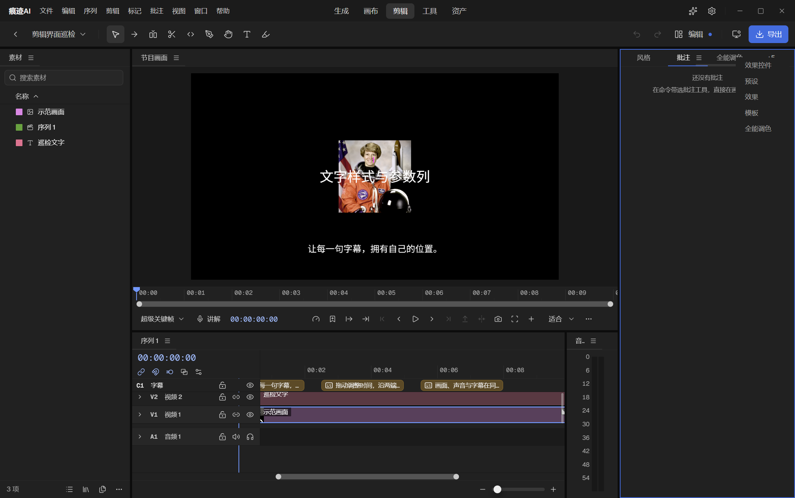
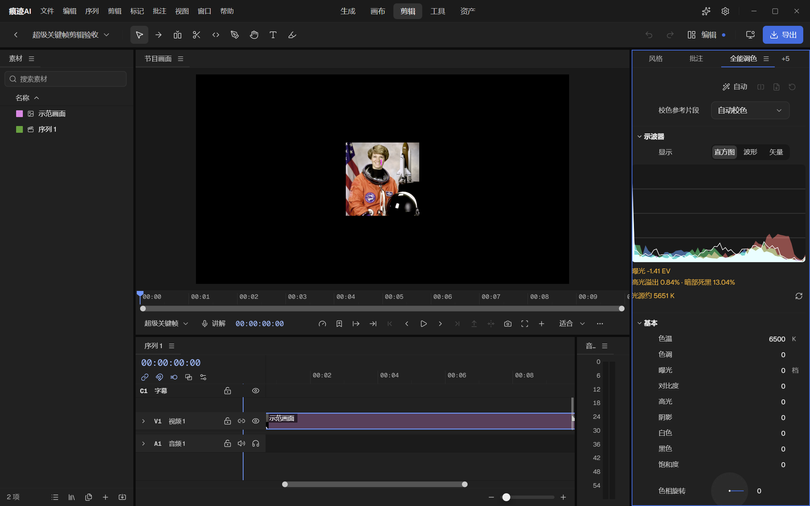
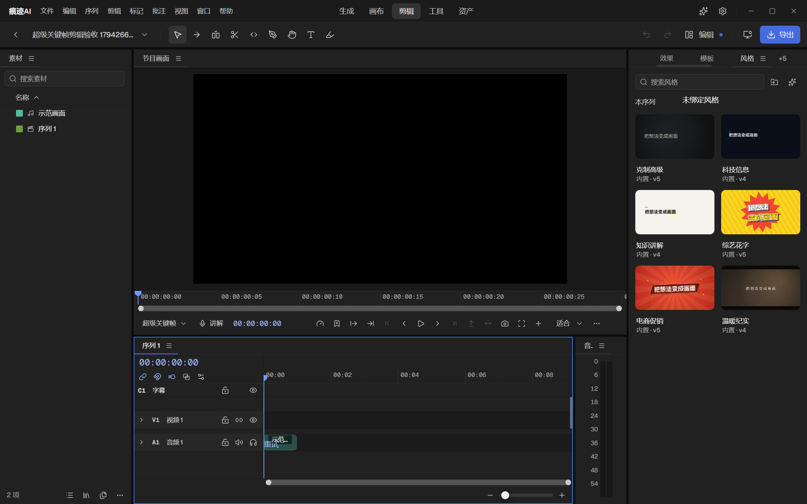

# 07 界面精致度复查

返回[总表](README.md)。改这一组前必读：[frontend-ui.md](../../rules/frontend-ui.md)，并调用 skill `henji-ui-surface`。**这一组任务只交给 Claude，不交给 Codex。**

## 这次看了什么

用 `ui:tour` 在真实 Electron 窗口（1440×900，石墨主题，隔离数据）里截图后逐张看。巡检场景本身有一半过期跑不通（见 [06 的 R6](06-可删除与可简化.md#r6)），所以实际只看到了**剪辑工作区的 4 个状态和设置的外观页**。下面的结论对这两处是有截图为证的；生成、画布、图片编辑、镜头参考、音频编辑、助手侧栏这次没有看到，不能下结论。全量复查排成了任务 [V9](#v9)。

证据截图在 [截图/](截图/) 下。

## 先回答“为什么看着廉价”

共享组件的复用率其实很高：剪辑里的弹窗 79 处全部走 `UiModal`，错误提示 107 处全部走 `UiError`，通知走统一的入口。所以问题不是“各写各的组件”，而是三件事：

1. **共享组件本身在某些场合不够好看。** 最典型的就是报错：`UiError` 只有一行红字加一行灰字，没有图标、没有底、没有层次。它放在面板中央当空状态还行，压在节目画面上当报错就像一段没排版的调试输出。组件统一了，但只有一种样子，套不住所有场合。
2. **组件覆盖不到的地方是原样的。** 停靠面板的标签溢出菜单是第三方库自带的弹层，没有接进应用的浮层样式，所以是一排浮在内容上的裸字（V1）。时间线片段、示波器、调色读数这些自绘内容各有各的画法。
3. **细节没人逐个收。** 对齐差几个像素、文字被裁掉半行、白色圆点太亮、整块面板一圈亮蓝框。每一处单看都不算错，凑在一起就是“不精致”。静态门禁查得出“用没用对组件”，查不出“好不好看”。

下面按影响从大到小排。

---

## V1（P1）标签溢出菜单没有底，文字直接压在面板内容上

剪辑右侧面板组标签放不下时点“+N”，弹出的菜单（效果控件、预设、效果、模板、全能调色）没有背景、没有描边，直接叠在下面的“还没有批注”说明文字上，两层字混在一起。旁边的“全能调色”标签也被切掉一半。

原因：这个弹层是 dockview 自带的，[index.css:1181](../../../src/index.css) 只给它设了最小宽度，没有给表面样式。

**做法：** 给 `.dv-tabs-overflow-container` 套上和应用菜单同一套浮层表面（`UI_TRIGGER_PANEL_SURFACE_CLASS` 对应的底色、描边、圆角、内边距），菜单项用和 `UiOptionButton variant="menu"` 一样的行高、悬停底和字号。更彻底的做法是用应用自己的 `ContextMenu` 替换这个弹层，键盘操作和毛玻璃设置也就一起对上了；dockview 支持自定义溢出渲染的话优先走这条。

**验收：** 四个停靠工作区（剪辑、音频编辑、镜头参考、图片编辑）各把面板拖窄到出现“+N”，点开截图。

---

## V2（P1）报错和提示的样子：重做 `UiError`，区分三种场合

这就是“剪辑里的报错窗口很不好看”的来源。现状（[states.tsx:161](../../../src/components/ui/states.tsx)）：

- 标题是 14 号红字，正文是 12 号灰字，没有图标。
- 节目画面出错时（[VideoEditPreview.tsx:1123](../../../src/features/videoEdit/VideoEditPreview.tsx)）是把它塞进一个 `UiPanel`，再跟一个没有底的“运行”按钮，贴在画面底部。
- 正文多数是程序抛出的原始错误信息，直接显示给用户。剪辑里有 115 处 `setError(...)`，大部分是把 `error.message` 原样传过去。

**做法：**

1. **`UiError` 加图标和三种场合的外观**（有限枚举，调用点不写样式）：
   - `block`（默认，面板中央）：上方一个 20 号的警示图标，危险色；标题 14 号用主要文字色而不是红色，红色只留给图标；正文次要文字色；按钮在下。整块红字读起来像系统崩了，只让图标带颜色更克制，也更清楚。
   - `inline`（表单行、列表行里）：一行，前面 14 号图标，后面一句话，可截断加悬停看全。现有的 `UiInlineStatus` 已经是这个，把还在用 `UiError size="sm"` 凑的地方换过去。
   - `overlay`（压在画面、画布上）：实底浮起小条，左图标、中间标题加一行正文、右边动作按钮；用 `secondary` 按钮而不是无底的 `quiet`。节目画面出错、效果被跳过、预览已简化这几种状态都用它，位置统一在画面左下角。
2. **错误文案分两层。** 标题说发生了什么（“这段视频解不出画面”），正文说用户能做什么（“换一个文件，或在素材上右键重新链接”）。原始错误信息收进“详情”折叠区，带一个复制按钮。提供一个把常见错误码翻成这两句话的函数，各面板的 `setError` 逐步改成传错误对象而不是字符串。
3. **确认弹窗 `AlertDialog`**：现在是图标和标题挤在一行。改成图标在左上、标题和正文在右侧同一列对齐，按钮行与正文左缘对齐到右；破坏性确认的图标和主按钮同为危险色。
4. 在设计系统中心页（`dev.ui_gallery`）补上这三种场合的样张，各配长标题、长正文、无正文、带两个动作的变体。

**注意：**
- 这是公共组件改动，影响全应用 100 多处，按 L2 做；改完要看真实截图，至少覆盖剪辑节目画面出错、导出预览出错、画布节点出错、设置里拉取模型失败四处。
- 文案改动要同时进中英文词条。
- 不要顺手把提示（“请先选择片段”）也画成报错：那是 `UiEmpty`。

---

## V3（P1）面板聚焦的蓝框太重，面板之间的黑缝太宽

当前聚焦的面板组四周有一圈明亮的蓝色描边，整个右侧栏像被选中的图片；面板之间是约 4 像素的纯黑缝。两样加起来，界面看起来是一个个“盒子”摆在黑底上，而不是一整块工作台。

对照 Premiere：聚焦面板也有蓝框，但只有 1 像素，颜色也更暗。

**做法（已定）：**
- 聚焦描边改成 1 像素，颜色用强调色与面板底混合到约 60% 的那一档（新增一个语义令牌，四套主题都由引擎推导）。当前标签下的强调色细线已经在表达“这个面板是当前的”，描边只需要若有若无。
- 面板间隙从 4 像素改成 2 像素，缝的颜色保持 `gap`。
- 改完四套主题各截一张对比。

---

## V4（P2）调色面板的排版

同一张截图里的问题：

1. **诊断读数贴边**：“曝光 -1.41 EV”“高光溢出 0.84% · 暗部死黑 13.04%”“光源约 5651 K”三行橙色字紧贴面板左边缘，第一个字被切掉一点，和下面所有参数行的左缘（缩进约 60 像素）对不上。三行都用橙色，但只有“溢出、死黑”是警告，“曝光、光源”是普通读数。
   - 做法：读数与参数名同一左缘；普通读数用次要文字色，只有超出阈值的那一项标成警告色；三行并成一行读数条。
2. **直方图顶到两边**：图形左右没有内边距，左侧越过了面板边线；白色亮度曲线的填充在底部堆成一片白。
   - 做法：加上与参数行一致的左右内边距；亮度曲线只描线、不填充，或用很低的不透明度。
3. **参数行太空**：参数名在左，数值“0”在最右，中间 250 像素什么都没有；单位（K、档）有的行有、有的行没有，挂在数值后面参差不齐。看起来像没填完的表格。
   - 做法：这是“属性面板”排布（悬停拖动改值，不画滑杆）的既定设计，不改交互。改两点：数值为默认值时用次要文字色，改过的值才用主要文字色加强调（规则里的“例外才显眼”）；单位统一进固定宽度的单位道，没有单位的行留空位保持对齐（`UiPropertyUnit` 已经支持，调用点没用齐）。
4. **色相旋转的圆盘被面板底边切掉一半**：滚动区的底部内边距不够，最后一个控件露一半。给滚动区加底部留白。
5. **右上角三个灰色小图标**（“自动”右边）没有名称，颜色淡到像禁用。它们确实是禁用状态的话，按规则“不可用就不出现”隐藏；不是的话恢复正常对比度。

---

## V5（P2）时间线片段的画法

1. **文字被裁、文字相叠**：V2 轨道上“巡检文字”的片段名上半截被裁掉；音频片段很短时，片段名“示范…”和失败后的“重试”两个字叠在一起。
   - 做法：片段名按轨道高度垂直居中，轨道矮于字高时不显示名字；片段宽度不够放“名字 + 状态”时只留状态图标（一个小的警示图标，悬停显示“波形读取失败，点击重试”），不放文字链接。
2. **三种片段三种画法**：字幕是琥珀色描边加图标的胶囊，视频是没有描边的暗紫色平块、名字放在一块深色小标签上，音频是带描边的青色块。
   - 做法：定一套片段规范并写进 skill：圆角、有没有描边、名字放哪、选中态怎么画（现在是蓝色细框）、颜色标签怎么体现（整块着色还是只着一条边）。建议：统一 4 像素圆角、不描边、名字直接写在片段左上角（主要文字色，下面垫一层由片段颜色加深得到的渐隐底，保证看得清），颜色标签整块着色但降低饱和度；字幕片段沿用同一规范，只多一个图标。
3. **片段起点的黑白三角小标记**（“示范画面”左下角）看起来像渲染残留。确认它表达什么（淡入控制点或修剪指示），按图标规范重画；没有含义就去掉。

---

## V6（P2）字体：中文和拉丁字不是一家

界面拉丁字和数字用 Geist，中文落到系统的微软雅黑。两者的字重、字面大小和基线不一致：同一行里数字细、汉字粗；20 号加粗的分区标题（“外观”“实验性功能”）用雅黑粗体显得很笨重；12、13 号的小字雅黑渲染偏糊。这是“廉价感”里最底层、也最普遍的一个来源，每一屏都有。

**决定：随包带一套中文界面字体，用 HarmonyOS Sans SC**（可免费商用，用户做视频时已经在用，字形现代，和 Geist 的骨架接近）。带 Regular、Medium 两个字重，粗体标题改用 Medium 加大字号来体现层级，不用 Bold。

**做法：**
1. 先在设计系统中心页做一张对照样张：同一组界面文字（各字号、各字重、中英数字混排、时间码旁的标签）分别用雅黑和 HarmonyOS Sans SC 渲染，截图放大看 12、13 号的清晰度。
2. 清晰度不比雅黑差就采用：字体文件随包（两个字重约 16 MB），写进字体栈，排在 Geist 之后、系统字体之前。macOS 上苹方的效果本来就好，可以只在 Windows 上启用，由样张决定。
3. 标题层级改用“字号 + Medium”，把现在 `font-semibold` / `font-bold` 的中文标题过一遍。
4. 如果 12 号下 HarmonyOS 明显不如雅黑清晰（Windows 的字体渲染对没有针对小字号优化的字体不友好），退回方案：保留雅黑，只把标题字重从粗体降到常规加大一号，并把 13 号正文的字距恢复为 0。

**注意：** 字体是全局令牌，属于公共底座，改的时候不能有其他界面任务并行。许可证文件要进 `resources/licenses`。

---

## V7（P2）零散的视觉噪声

都来自这几张截图，每条都很小：

1. **白色圆点太亮**：节目画面下方和时间线下方的缩放滚动条两端是纯白圆点，缩放滑杆的手柄也是纯白，在深色界面里比任何内容都抢眼。改成次要文字色那一档的灰，悬停或拖动时才变亮。
2. **风格卡片上的“内置 · v5”**：版本号对选风格没有帮助，属于不该出现在正式界面的内部信息。去掉版本号；“内置”也只在同时存在用户自建风格时才需要标。
3. **“编辑”后面的蓝点**没有说明。它如果表示布局改过未保存，悬停要有说明；如果没有含义就去掉。
4. **音频电平面板的标题被截成“音..”**：面板太窄放不下自己的名字。这个面板不需要标题，标签直接用图标，或把面板最小宽度调到放得下“音量”两个字。
5. **右侧面板组默认塞了 9 个标签**（显示 3 个，其余在“+6”里）。默认布局里把它们分成两组，或者默认只打开最常用的 4 个，其余从“窗口”菜单打开。
6. **顶部菜单栏和工作区导航一样重**：左边“文件 编辑 序列…”和中间“生成 画布 剪辑…”字号、颜色相同，两组导航在抢。菜单栏降到次要文字色，悬停才变亮；工作区导航保持主要文字色。
7. **播放控制条 14 个图标一字排开**，粗细大小都一样，其中 4 个是禁用的灰色。按功能分成三段（标记与入出点 / 播放 / 画面工具），段与段之间加大间距；当前用不了的按规则隐藏。
8. **设置页**（[截图](截图/设置-外观.png)）：
   - 选中的主题预设是一整块 250 像素宽的亮蓝色，是这一页最抢眼的东西，而它只是个当前值。改成中性选中底加一个勾，或者只给预设的小色块加一圈描边。
   - 设置行标签在最左、控件在最右，中间隔了 800 多像素，眼睛要横跨整个弹窗去对应。把设置内容区的最大宽度收到 640 左右。
   - 弹窗后面透出几团蓝色光晕（右下角最明显），是背后生成页的强调色按钮被遮罩模糊后的样子。遮罩加深或降低饱和度，让弹窗后面是安静的。
   - 左侧导航的滚动条比别处粗。

---

## V8（P2）把“精致”变成能检查的规则

静态门禁已经很多，但都在查“用没用对”，上面这些问题一条都拦不住。建议补三样，都要是能自动跑的：

1. **裁切与相叠**：`check:ui-visual` 已经有 `controlClipped`、`controlOccluded` 两条规则，但时间线片段、示波器这类自绘区域标了“自绘滚动区”被整体跳过。给片段名、读数这类自绘文字补上“文字不得被裁、不得相叠”的检查。
2. **对齐**：同一个面板里所有行的左缘只允许落在登记的两三条竖线上。在真实 DOM 上量每一行文字的左坐标，出现第四条线就报。调色面板的读数贴边能被这条抓到。
3. **第三方弹层必须有表面**：任何可见的浮层（`position: fixed/absolute` 且盖在其他内容上）必须有不透明的底。V1 能被这条抓到。

另外把“眯眼测试”写进验收流程：每张截图缩到四分之一大小看，最先跳出来的必须是正在处理的内容或唯一的主动作。现在缩小后最先跳出来的是蓝色聚焦框、白色圆点和蓝色主题块。

---

## V9（P1）全应用逐屏复查

这次只看了两处。要回答“整个软件是不是统一”，需要把每个工作区都看一遍。

**做法：**

1. 先做完 [R6](06-可删除与可简化.md#r6)，让巡检场景能跑通。
2. 定一份“必看屏幕”清单，约 40 屏，每个工作区都要包含四类状态：**常态、空状态、出错、弹窗或浮层打开**。建议清单：
   - 生成：空历史、有历史、参数面板展开、模型选择面板、生成失败的任务卡、提示词优化中。
   - 画布：空画布、十几个节点、节点参数展开、节点出错、右键菜单、局部重绘编辑器。
   - 剪辑：默认布局、效果控件、全能调色、导出弹窗、导出失败、素材离线、代码素材出错、快捷键设置、面板拖窄到最小。
   - 图片编辑：空态、多图层、选区工具选项、滤镜面板、扩图进行中、导出弹窗。
   - 镜头参考：工程列表、场景编辑、角色加载失败、渲染进行中。
   - 音频编辑：波形、逐字稿、效果链、录音中、转写失败。
   - 屏幕录制与网页录制：准备面板、录制控制条、录制列表。
   - 全局：设置每个分区、助手侧栏（空、对话中、工具调用、付费确认）、素材库浮层、首次引导、更新提示、各种确认弹窗。
3. 四套主题里看石墨和纸白两套；窗口看 1440×900 和 960×640 两个尺寸。
4. 逐张按 skill 的自检清单和本文件 V8 的“眯眼测试”过，问题记进本目录新建的 `09-逐屏问题清单.md`，按工作区分节，每条带截图。
5. 修的时候按“公共组件问题 → 令牌问题 → 单个界面问题”的顺序，先修能一次改好一片的。

**注意：** 截图由执行者自己逐张看，不能只看规则命中表。每轮看 10 张左右就停下来整理，避免看多了走过场。

---

## 已定的方向（不用再问）

| 事项 | 决定 |
|---|---|
| 面板聚焦描边 | 保留（对齐 Premiere 的习惯），减到 1 像素、降低亮度 |
| 中文字体 | 随包带 HarmonyOS Sans SC 两个字重；小字清晰度不如雅黑就退回方案 |
| 报错的颜色 | 只让图标用危险色，标题用主要文字色 |
| 属性面板要不要画滑杆 | 不画，保持拖动改值；靠“默认值变淡”解决空旷感 |
| 时间线片段 | 统一一套规范，不描边，名字写在片段上 |
| 设置内容区宽度 | 收到 640 左右 |
| 英文界面 | 2.0 只做中文，语言切换先收起来（[04 的 U2](04-界面与体验.md#u2) 选 A） |
