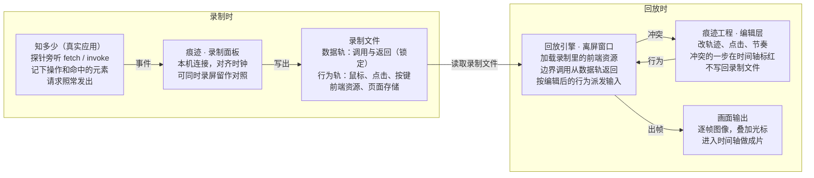

# 网页应用录制与重演方案（初版）

> 2026-10-23 · 由「知多少」一侧起草，供痕迹 AI 评审后出最终方案。

痕迹 AI 新增一项能力：连接用网页技术做的应用，把一次操作录成数据文件，而不是视频。回放时不再请求 API，由应用自己的界面代码按录下的数据重演。鼠标和点击可以后期随意改，API 请求和返回锁定不变。

## 已定的决定

这些已经和需求方确认，评审时不需要再讨论。

| 事项 | 决定 |
| --- | --- |
| 归属 | 做成痕迹 AI 的一项能力，不放进被录应用 |
| 适用范围 | 只考虑网页技术做的应用（Tauri、Electron、网页）。初期只服务需求方自己的应用，第一个接入的是「知多少」 |
| 录制内容 | 界面上有什么就录什么，包括自定义标题栏、密钥输入框等，录制时不做任何隐私处理 |
| 隐私 | 对外传播的是成片视频，不是录制文件；打码由痕迹 AI 的现有能力或作者自己处理 |
| 鼠标与点击 | 可以随意改：轨迹、位置、时间，也可以改成点到别的元素上，尽量开放 |
| 打字 | 文字内容不能改，打字节奏可以改 |
| API 请求与返回 | 内容锁定，不允许产生新请求；等待和流式返回的节奏可以压缩或拉长 |
| 开发顺序 | 先在痕迹 AI 侧开发，完成后再给被录应用出适配说明，由被录应用一侧接入 |

## 核心思路

核心是录"因"不录"果"。只录页面和外界之间的所有边界调用，再加上用户的操作。回放时从应用启动开始，把这些调用的结果原样喂给应用，界面由应用自己的代码重新算出来。游戏录像和 Redux DevTools 的"时间旅行"都是同一个原理。

"边界调用"指页面自己算不出来、需要问外界的一切：

- **网络**：`fetch`、XHR、EventSource、WebSocket，包括流式返回的每一块和它到达的时间。
- **宿主调用**：Tauri 的 `invoke`、Electron 的 IPC。知多少的接口请求走的是 Tauri 的 HTTP 插件，读写历史和设置也走 `invoke`，所以对它来说这一类是主体。
- **不确定值**：当前时间、随机数、窗口尺寸、系统深浅色、文件选择和拖入的文件、剪贴板。
- **用户操作**：鼠标、点击、滚动、按键和输入的文字。

前三类合起来是**数据轨**，录下后锁定；第四类是**行为轨**，可以后期编辑。只要从应用启动就开始录，启动时读历史、读设置这些调用也会进数据轨，所以不需要另外保存状态快照。

这样做有三个好处：

- 回放不联网，也不花钱。
- 画面是真实界面重新渲染的，可以换分辨率、调速度。
- 改了行为之后，应用的反应也是真实的：悬停效果、弹层、动画都会跟着变。

## 整体架构

录制文件是两边的交接点：录制时只写出它，回放时引擎只读它和编辑层，不需要被录应用在运行。

## 录制流程

录制时用户操作的是真实应用，请求也是真实的。探针在页面里记下一切，实时发给痕迹。

1. **连接**：痕迹在本机开一个固定端口（只监听 127.0.0.1）。被录应用里的探针启动后自动连过来，痕迹的录制面板里就能看到"知多少已连接"。痕迹当中心，多个应用不会抢端口。反过来由应用开端口、痕迹去连也可以，请痕迹 AI 定。
2. **握手**：探针报上应用名、版本、探针版本、窗口尺寸、像素比、深浅色。双方来回对几次表，算出探针时钟和痕迹录制时钟（`captureLog` 的 `monoUs`）之间的偏移。
3. **开始**：痕迹发出开始指令，探针把页面重新加载一次，从应用启动开始录。这样数据轨能覆盖启动时的所有调用，不用做状态快照。代价是界面会回到启动页，对录教程影响不大。
4. **录制中**：探针实时发送数据轨和行为轨的事件。痕迹可以同时照常录屏，留一份原始画面做对照。标记、暂停、停止沿用痕迹现有的录制快捷键。
5. **停止**：探针把页面当前用到的前端资源（`index.html`、脚本、样式、字体、图片）发给痕迹，痕迹把所有内容写成一个录制文件。

探针在录制时只是旁听：调用照常发出去，结果复制一份记下，不改变应用行为。录制内容不做脱敏，请求头里的密钥、输入框里的密钥都会原样进文件。

## 录制文件格式

一次录制是一个压缩包，里面的内容都用 zod 定义并校验。事件尽量沿用痕迹现有 `captureLog` 的写法（`seq`、`monoUs`、分页）。后期编辑不写回这个文件，而是作为一层改动存在痕迹工程里，原始录制始终不变。

| 内容 | 说明 |
| --- | --- |
| 清单 | 格式版本、应用名和版本、探针版本、宿主类型（Tauri / Electron / 网页）、窗口尺寸和像素比、深浅色、录制时长、和痕迹时钟的偏移 |
| 数据轨 | 每一次边界调用：通道（网络 / 宿主调用 / 不确定值）、发出时间、请求内容、返回内容；流式返回拆成块，每块记相对发出时刻的偏移 |
| 行为轨 | 鼠标移动采样、按下与抬起、滚动、按键、输入的文字；每个事件同时记坐标和命中的元素（见下一行） |
| 元素信息 | 事件发生时命中元素的标识、角色、可读名称、当时的位置和大小，以及点击点在元素内的相对位置；痕迹的自动缩放、字幕、分章节也用它 |
| 应用动作 | 可选。应用主动报的语义事件，例如"提问：PHP 是啥""回答完成"，便于痕迹理解录制 |
| 前端资源 | 录制时加载过的 `index.html`、脚本、样式、字体、图片，按内容哈希去重；有了它，应用以后升级了，旧录制也能原样重演 |
| 页面存储 | `localStorage`、`sessionStorage`、IndexedDB 在录制开始、应用脚本运行前的内容；它们不算边界调用，但会影响启动状态，重演时先恢复再启动应用 |
| 二进制数据 | 用户拖入的图片、接口返回的图片等大块内容，按哈希单独存放，数据轨里只引用 |

体积估计：知多少一次提问的流式返回和搜索结果在几百 KB 量级，前端资源几 MB，一次十分钟的录制通常在 10 MB 以内。这是估算，待实测。

## 后期编辑规则

总规则是：**行为可以随便改，只要重演时应用发出的每一个边界调用，都能在数据轨里找到对应的一条**。找不到，就说明这个改动需要真实请求，不允许。

**点击按元素重放，光标只是画上去的**。重演时，引擎先把光标按编辑后的轨迹动画到位，再把按下、抬起派发到目标元素上。派发位置 = 目标元素当时的位置 + 点击点在元素内的相对位置。这样即使页面布局稍有变化、或者光标轨迹被改了，动作也不会点空。作者把点击拖到另一个元素上，就是换了目标元素。

| 改动 | 结果 |
| --- | --- |
| 改鼠标轨迹、移动速度、点击时刻 | 永远允许 |
| 改点击落在同一元素内的位置 | 永远允许 |
| 改成点另一个元素、增加或删除点击 | 允许，但要通过试重演检查。例如打开另一个节点的详情不发请求，可以；对另一个节点点"深入了解"会发新请求，拦下 |
| 改打字节奏 | 允许 |
| 改打字内容 | 不允许，编辑界面里不提供 |
| 压缩或拉长等待、流式返回的节奏 | 允许，内容和块的顺序不变 |
| 改返回内容、让应用发出录制里没有的请求 | 不允许 |

**调用怎么对应**：每个通道按发出顺序排队，再用请求指纹核对。网络请求的指纹是方法 + 地址 + 请求体哈希，宿主调用的指纹是命令名 + 参数哈希。时间和随机数也来自数据轨，所以请求体里带的日期在重演时也一致。不确定值是例外：取当前时间这类调用的次数会随行为变化，由引擎按重演时钟给值，不做一一对应。

**冲突怎么呈现**：作者每改一处行为，痕迹就在后台快速试重演一遍。出现对不上的调用，就把导致它的那个行为事件在时间轴上标红，写明"这一步会发出录制里没有的请求：POST …"。录制里有、重演时没用到的调用不算冲突，只给提示。

## 回放引擎

建议直接用痕迹自己的 Electron：开一个隐藏或离屏的窗口，加载录制文件里的前端资源。不启动被录应用本身，也不用另带一个浏览器。被录应用的界面本质上是网页，自定义标题栏也是网页的一部分，按录制时的窗口尺寸渲染出来就是完整画面。

引擎要做四件事：

1. **提供页面**：用自定义协议把录制包里的前端资源当成站点提供出去，页面尺寸、像素比、深浅色按清单设置。
2. **接管边界调用**：在页面脚本运行前注入回放探针，把网络、Tauri 的 `invoke`、Electron IPC、时间和随机数都换成从数据轨取结果。对 Tauri 应用，探针要模拟一份 `window.__TAURI_INTERNALS__`，这样应用代码不用改。网络也可以在 Chromium 底层拦截（调试协议的 Fetch 域），作为兜底。
3. **控制时间**：页面里的定时器、`requestAnimationFrame`、CSS 动画都按引擎的时钟走。有两种做法：用 Chromium 调试协议的虚拟时间（`Emulation.setVirtualTimePolicy`）；或者由探针自己替换时钟，再用 `document.getAnimations()` 控制 CSS 动画的 `currentTime`。
4. **重放行为、出画面**：按编辑后的行为轨派发输入事件。用调试协议的 `Input.dispatchMouseEvent` 等接口，页面收到的是受信任的真实输入。光标由痕迹现有的录屏光标模块叠加上去，画面用离屏渲染逐帧取图。

建议分两档实现：

- **第一档，实时重演**：按真实时间跑，边跑边取帧。等待压缩通过改数据轨的返回节奏来实现。实现简单，偶尔会掉帧。
- **第二档，确定性逐帧**：时间完全由引擎推进，每推进一帧取一张图。任意分辨率、任意帧率下，同一份编辑每次渲染的结果都完全一致。痕迹的时间轴可以拖到任意一帧预览，做法是从最近的检查点快速重演到那一帧。

试重演检查和正式渲染用同一个引擎，区别是试重演不取画面，时间全速推进。

## 被录应用要做的适配（以知多少为例）

目标是被录应用只做很薄的一层，大部分工作由痕迹提供的探针包完成。

1. **引入探针**：在应用入口的最前面初始化痕迹提供的探针包，传入应用名和版本。探针自己包装 `fetch`、`invoke`、时间、随机数，并监听输入事件。探针只在开启录制连接时生效（例如开发模式下，或打开一个开关），平时不影响应用。
2. **给元素起名字**：给重要的可点元素加上稳定的标识。探针优先用这个标识定位元素，没有时再用无障碍名称和 DOM 路径。知多少的按钮已经带了 `data-act`（如 `detail`、`retry`、`collapse`），节点也有 id，可以直接用。具体用哪个属性名由痕迹定。
3. **报应用动作（可选）**：在关键处调用探针，报一个语义事件，例如提问、开始搜索、回答完成。
4. **去掉边界外的不确定性**：检查有没有绕过探针的外部调用，例如直接访问系统字体列表、用 Web Worker 自己发请求。知多少的接口请求都经过 `src/core/debug.ts` 的 `tracedFetch`，底层走 Tauri 的 HTTP 插件，都在探针覆盖范围内。

被录应用不需要自己实现回放模式，也不需要实现"跳到某一帧"，这些都由回放引擎在页面外部完成。

## 分工与开发顺序

痕迹 AI 一侧先开发规范、探针包和引擎。完成后出一份适配说明，写清探针怎么引入、元素怎么命名、有哪些禁忌，知多少再按说明接入。痕迹开发期间需要一个真实应用来测试，可以先在本地的知多少副本里临时接上探针；正式接入仍由知多少一侧完成。

| 阶段 | 痕迹 AI 侧 | 被录应用侧 | 验收 |
| --- | --- | --- | --- |
| 1. 录得下、放得出 | 文件格式 v0、探针包（录制 + 回放）、连接与对时、引擎实时重演 | 引入探针包 | 录一次知多少的真实提问，断网重演，画面和录制时一致 |
| 2. 能改行为 | 行为轨编辑界面、试重演检查、冲突标红、等待压缩 | 给元素补标识、报应用动作 | 把一次点击改到另一个节点：不发请求的放行，会发请求的拦下 |
| 3. 确定性逐帧 | 引擎接管时钟、逐帧渲染、时间轴任意帧预览 | 无 | 同一份编辑渲染两次，逐帧对比一致 |
| 4. 接进制作流程 | 录制作为时间轴素材；元素信息驱动自动缩放、字幕、分章节；可选导出成代码素材的参数 | 无 | 用一次录制做出一段带自动镜头的成片 |

## 风险和待定问题

风险：

- **渲染环境不同**：知多少录制时跑在 WebView2，重演时跑在 Electron 的 Chromium，两边版本不同，字体渲染或较新的 CSS 特性可能有细微差异。点击按元素重放，所以动作仍然对得上；画面上的差异需要实测。
- **漏掉的边界**：只要有一个外部调用没被探针接管，重演就会出现偏差。引擎遇到页面尝试未接管的外部访问时应该直接报错，而不是放行。
- **系统字体**：应用用到的系统字体不在前端资源里，换一台电脑重演，字体可能不同。初期在同一台电脑上录和放，影响不大。
- **录制文件含密钥**：按已定的决定不做脱敏，所以录制文件本身不要外传。

请痕迹 AI 定的问题：

1. 连接方向：痕迹开端口、探针连过来，还是反过来？
2. 时间控制：用 Chromium 的虚拟时间，还是由探针自己替换时钟？两种做法对 CSS 动画、视频元素的覆盖程度不同。
3. 文件格式和 `captureLog` 的关系：行为轨直接复用 `captureEventSchema` 并扩展事件种类，还是单独定义、导入时再转换？
4. 开始录制时重新加载页面，能不能接受？不接受的话就需要引入状态快照，复杂度会明显上升。
5. 录制在痕迹里归哪一类文档或素材？编辑层存在哪里？
